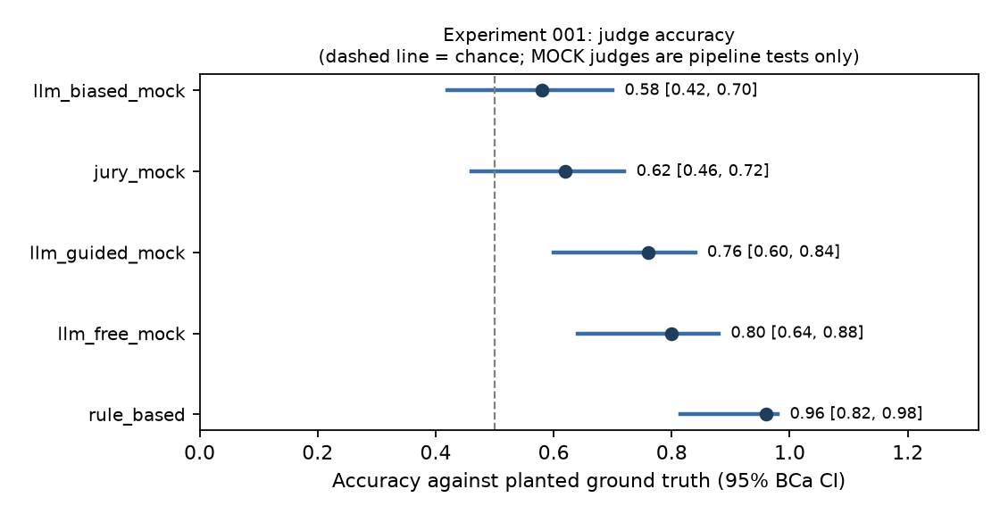
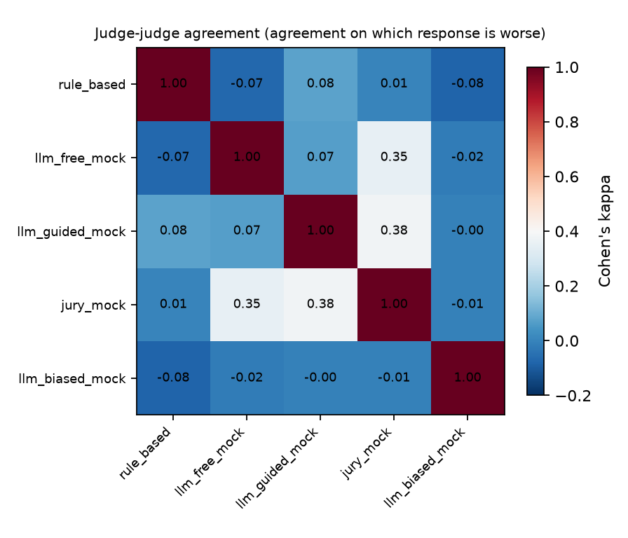
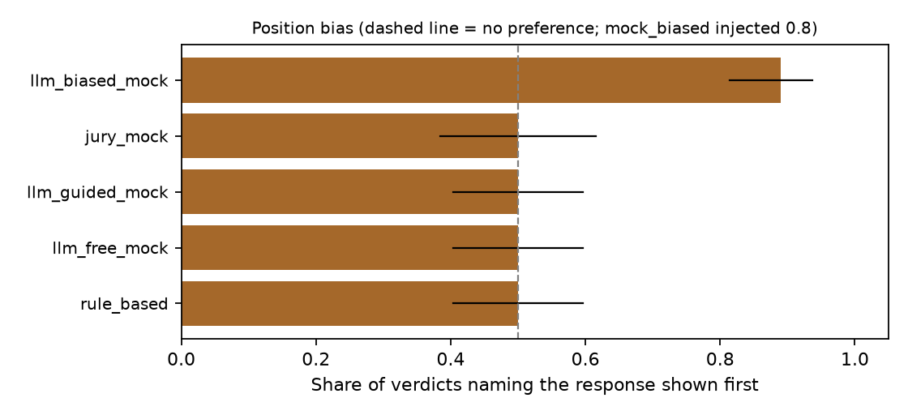

# REPORT — plain-language summary (v0.1 + v0.2)

Written for a reader who is a doctor, not a software engineer. If you read only
one section, read "What this does **not** say" at the end.

> **v0.2.0 update (2026-11-17).** Experiment 002 now ran against a real model, and
> the local web app exists. Read `REPORT_v0.2.md` for those results. In one line:
> one judge (DeepSeek) agreed with the official MedQA key on 58 of 59 scorable
> items (98.3%, 95% CI 91.0–99.7%), the second judge could not run because no local
> model is installed, and at that accuracy the 60-item sample is at ceiling — so the
> question the experiment was designed to answer, whether two judges from different
> families make correlated errors, is **not yet answered**. Everything below about
> v0.1 is unchanged.

---

## 1. What was built, in one paragraph

A small, self-contained laboratory for checking whether a medical AI evaluation
is *trustworthy as a measurement* — before anyone argues about whether the AI is
good. It (a) audits public medical benchmark items for duplicates, answer-key
problems and shortcut artefacts; (b) defines eight evaluation criteria in a
versioned catalogue, each tied to published literature; (c) implements the
metrics those criteria need, including calibration; (d) runs four kinds of judge
(exact match, rules, a single LLM with a rubric, a jury) and records who judged
what, with which prompt and seed; and (e) reports how much the judges agree with
each other, with themselves, and with known ground truth.

All of it is reproducible with one command and is tested.

## 2. How to run it

```powershell
cd <repo>
.\run_all.cmd
```

It takes a few minutes on a CPU-only laptop. Outputs appear in `results/`. If you
only want one piece, `python -m medeval audit` or `python -m medeval experiment001`
each run on their own.

## 3. What the audit found in the public benchmarks

Two multiple-choice benchmarks were inspected, item by item. Nothing was changed
or deleted — problems are flagged, not fixed, so that other people's results stay
comparable.

**MedMCQA** (validation split, 4 183 items, Apache-2.0):

- **0 raw-string exact-duplicate groups**. The reported groups are **identical
  after normalisation** (lowercasing and punctuation stripping), not literal
  raw-string duplicates. A model that memorises one normalised form can still
  receive credit for both.
- **21 items whose own answer options repeat** (the same option text twice).
- **88 items share an identical set of four options** with another item, so the
  "choices" carry no information about which question is being asked.
- **The answer key is not evenly spread**: option A is correct 32% of the time,
  option D 19.7% (p ≈ 4 × 10⁻³² against an even split).
- **You can score 32% by always answering A**, and 31% by always picking the
  longest option — both above the 25% chance line, without any medical knowledge.
- 85 items were flagged in total. No missing or out-of-range keys were found, and
  the key uses 0-based indexing (0 = A), which matches how the harness reads it.

**MedQA** (dev split, 1 272 items, CC-BY-SA-4.0):

- No duplicate questions and no repeated options.
- Key spread is mildly uneven (A 26%, B 25%, C 28%, D 22%; p = 0.017), with a
  multiple-comparison caveat.
- The always-A shortcut scores 26% and the longest-option shortcut 27% — essentially
  chance, which is the healthy result.
- 3 items were flagged by the answer-echo screen.

**PubMedQA** could not be loaded. Its Hugging Face dataset still uses an old
loading script that the installed `datasets` version refuses to run. It was
skipped and recorded, not silently dropped. See `VERIFY_ME.md`.

**What this means:** if you compare two models on MedMCQA, part of the difference
can come from duplicated items, an uneven key, and option length rather than from
medical reasoning. The audit quantifies that, and the reports list the flagged
item IDs so you can exclude them in a sensitivity analysis.

## 4. Experiment 001 — can a judge be trusted as a measuring instrument?

Fifty synthetic cases were written, each containing one response with a single
deliberately planted error (wrong diagnosis, contraindicated drug, wrong dose,
unsafe recommendation, or a critical omission — 15/10/10/8/7). Five judge
configurations decided *which of the two responses is more dangerous*.

**The honest headline: the LLM judges could not be tested here.** There was no API
key, no local model server, and no CPU model installed, so the LLM judges ran on a
deterministic **MOCK** backend — a simulated judge with a known accuracy that
exists to prove the analysis code works. Everything below from the mock judges is
labelled **PIPELINE TEST ONLY**. The rule judge is real.

| judge | what it is | accuracy vs planted truth (95% CI) |
|---|---|---|
| `rule_based` | deterministic rule file (real) | **0.96** [0.82, 0.98] |
| `llm_free_mock` | simulated, configured 75% | 0.80 [0.64, 0.88] |
| `llm_guided_mock` | simulated, configured 80% | 0.76 [0.60, 0.84] |
| `jury_mock` | majority of the two mocks | 0.62 [0.46, 0.72] |
| `llm_biased_mock` | simulated with injected position preference | 0.58 [0.42, 0.70] |



**Five things this experiment did establish:**

1. **The analysis code recovers known parameters.** The simulated judges were
   built with 75% and 80% accuracy; the pipeline estimated 80% and 76%, and both
   confidence intervals contain the configured value. That is exactly what a
   pipeline test should show before it is trusted with a real model.
2. **Position bias is measurable when it exists.** The negative-control judge was
   built to pick the response shown first 80% of the time; measured 89%
   (p = 3 × 10⁻¹⁶) and it changed its answer between the two presentation orders in
   78% of cases. The other judges sat at exactly 50%. So the bias probe has teeth.
3. **The rule judge found 48 of 50 planted errors**, and both misses were
   contraindicated-drug cases outside its rule list. Its limitation is coverage,
   not accuracy. Because rules were written with the v0.1 cases in view, this
   accuracy is an upper bound.
4. **A two-member jury is a bad design.** Requiring a majority of two produced a
   tie — scored as a miss — whenever the members disagreed, which dropped accuracy
   to 62% even though each member was individually more accurate. Juries need an
   odd number, or a tie rule, or a third judge.
5. **Kappa can be misleading here, and we report it next to a second statistic.**
   The rule judge and a mock judge agreed on 76% of cases — yet Cohen's kappa was
   **−0.07**, i.e. "no better than chance". That is the well-known prevalence
   paradox: when both judges are usually right, expected agreement is already high,
   so kappa collapses. Gwet's AC1 on the same data was **0.70** ("substantial").
   Reporting kappa alone would have produced a false "the judges disagree
   completely" headline.

**Self-consistency** (three seeds): the rule judge was perfectly consistent (1.00),
as a deterministic judge should be. The simulated judges were not (0.69–0.90 exact
agreement), which is what a sampling model does by construction.

The mock judges' errors were independent by construction. Their kappa and jury
results from Experiment 001 therefore do not generalise to real judges, whose
errors may be correlated.

**Length bias**: for every judge, the interval for "does it prefer longer answers
as more dangerous" included zero. No length effect was detected at n = 50, but the
interval is wide enough to hide a small one.




## 5. How the harness was used (and what those numbers are)

The upstream EleutherAI harness was left untouched and used for multiple-choice
baselines. The toolkit's task variants come in through `--include_path`, and the
Brier/NLL/confidence metrics through its plugin entry points. A smoke run with the
harness's `dummy` model (which emits pseudo-random logits) scored 40% on the
MedMCQA variant and 30% on the MedQA variant, with Brier 0.20/0.18.

**Those numbers are not a model's performance.** They prove the wiring works:
task → per-item log-probabilities → our per-item metrics → aggregation. Any real
score requires pointing the same pipeline at a real model.

## 6. What this does **not** say

- It does **not** say any model is safe, accurate, or unsafe. No model was
  evaluated in this environment.
- It does **not** validate the eight criteria clinically. They are
  **literature-derived, not clinician-validated**, and the two safety-related ones
  carry that phrase in the catalogue itself, enforced by the validator.
- It does **not** establish a clinician reference standard. There is no
  human-versus-machine agreement here; `human_reference` is empty everywhere by
  design, ready for a later version.
- It does **not** show that the benchmarks are contaminated. It shows some items
  are duplicated, the key is skewed, and shortcuts beat chance — which is enough
  to be careful, not enough to accuse.
- It does **not** support ranking systems by a single composite score. That is why
  no composite is reported in any conclusion.

## 7. What to look at first as a clinician

1. `packages/medeval_criteria/catalogue/v0.1/criteria.yaml` — the eight
   constructs and their anchored scales. This is where your judgement matters most.
2. `experiments/001_judge_reliability/data/case_specs_v0.1.json` — 50 cases with
   planted errors. Check whether each "bad" response is really the more dangerous
   one. If a case is arguable, that is a finding about the benchmark, not a bug.
3. `data/items/seed_v0.1.json` — the 50 seed items.

Then `NEXT_STEPS.md` explains how to turn the mock judges into real ones by
changing environment variables only.
